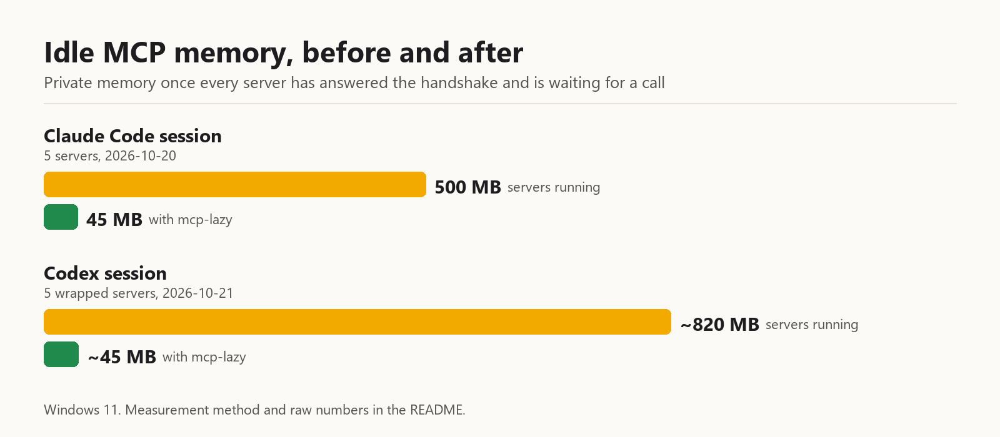

# mcp-lazy

[](https://github.com/WEBGRS/mcp-lazy/actions/workflows/tests.yml)
[](LICENSE)


Keep MCP servers asleep until a tool is called. mcp-lazy is a small stdio proxy for Claude Code
and Codex: it answers the handshake from cache, starts the real server on the first tool call, and
stops it again once it has been idle.



[中文说明](README.zh-CN.md)

## Quick start

```
git clone https://github.com/WEBGRS/mcp-lazy
cd mcp-lazy
python apply_config.py claude      # and/or: python apply_config.py codex
```

Restart Claude Code (or Codex). `python apply_config.py claude rollback` puts everything back.
Details in [Setup](#setup).

## Why

Every Claude Code session and every Codex app-server launches all of its configured MCP servers at
startup and keeps them running whether you call them or not. One evening I had nine Claude Code
sessions open, each running nine `node` processes for its MCP servers: 87 `node` processes, about
8 GB of memory, and a VS Code window that kept stalling. mcp-lazy sits between the client and each
server. Until a tool is actually called, the server does not exist.

## What it saves

One Claude Code session with five servers (2026-10-20): started directly, the five servers held
500.0 MB of private memory once each had answered the handshake and sat idle for 15 s. Wrapped, the
same session ran five sleeping proxies at 44.6 MB in total.

| Server | Started directly | Sleeping proxy |
|---|---|---|
| firecrawl | 60.7 MB | 9.0 MB |
| playwright (3 profiles) | 64.1 / 64.9 / 64.9 MB | 9.0 / 8.8 / 8.8 MB |
| rea | 245.5 MB | 9.0 MB |
| **Total** | **500.0 MB** | **44.6 MB** |

One Codex app-server, before and after (2026-10-21). Codex launched the npm servers through `npx`,
which is why each one costs more here:

| Server | Before | With mcp-lazy, until a tool is called |
|---|---|---|
| playwright (3 profiles) | ~145 MB each: `cmd` → `npx` → `cmd` → `node` | ~9 MB each |
| firecrawl | ~143 MB, same `npx` chain | ~9 MB |
| rea | ~243 MB | ~9 MB |
| *Subtotal, the five wrapped servers* | *~820 MB* | *~45 MB* |
| windows-mcp | ~800 MB, one `uvx` instance per app-server | none: points at a shared HTTP instance* |
| **Total** | **~1.6 GB** | **~45 MB** |

\* windows-mcp isn't proxied. I run one HTTP instance of it (837 MB) for every Claude Code session
and now Codex too, so Codex stopped starting its own.

The price is paid on the first call after a server has gone to sleep (median of 3 cold starts,
spawn plus `initialize`): playwright 0.5 s, firecrawl 0.9 s, rea 2.4 s.

How these were measured: "before" is the private memory (`psutil` `memory_info().private`) of every
process in each server's tree (for Claude Code: each server started on its own with `node`, 15 s
after the handshake; for Codex: the trees under the running app-server); "after" is the `PROXY MB`
column of `lazy_mcp.py --status`. Start times come from running the proxy against an empty cache
directory. Windows 11, Python 3.13, Node 24.

## How it works

- `initialize`, `tools/list`, `prompts/list`, `resources/list` and `resources/templates/list` are
  answered from `cache/NAME-<hash>/`, and `ping` and `logging/setLevel` are answered locally (the log
  level is replayed once the server starts). Anything else starts the server.
- The cache key covers the server command line, the client (`clientInfo.name`), the protocol version
  and the npm package version behind the script, so upgrading a package invalidates it by itself.
- After a start the proxy re-reads the lists in the background. If the client was given an outdated
  copy, it sends `notifications/*/list_changed`.
- A server is stopped after its idle timeout, but never while a request is in flight, a
  server-to-client request is unanswered, or a resource subscription is open. Notifications from the
  server don't count as activity.
- If the server crashes, in-flight requests get an error and the next call starts a fresh one.
- The server's process tree runs in a kill-on-close job object, so it dies with the proxy, even when
  the client kills the proxy instead of closing stdin (`codex exec` does that).
- `server/discover` is rejected with -32601, so clients that try it first fall back to `initialize`.

## Setup

Requirements: Python 3.11 or newer (only tested on 3.13 on Windows 11), plus whatever your servers
already need (Node, uv, ...). The proxy uses the standard library only.

```
git clone https://github.com/WEBGRS/mcp-lazy
cd mcp-lazy
python apply_config.py claude      # wrap the servers in ~/.claude.json
python apply_config.py codex       # wrap the servers in ~/.codex/config.toml
```

Restart the client afterwards. Keep the folder where it is: the configs now point at
`lazy_mcp.py` inside it.

`apply_config.py` changes every stdio server in the config (one with a `command`, not a `url`) to
run `python -I lazy_mcp.py NAME -- <its own command and args>`. `env`, `cwd`, timeouts and every
other key stay as they are. It saves the replaced values next to itself, keeps a timestamped
backup of the config, and warms the caches so even the first session starts nothing. For Codex it
edits the TOML in place and refuses to write unless the parsed result equals the old config with
only `command`, `args`, `url` and `http_headers` changed in those tables.

```
python apply_config.py claude rollback            # put the original commands back
python apply_config.py codex apply --only firecrawl,playwright*
python apply_config.py claude apply --skip my-server
```

Claude Code: only the user-level `mcpServers` in `~/.claude.json` are changed, not per-project
ones.

### local.json (optional)

A `local.json` next to the script (it isn't tracked by git) holds settings for your machine:

```json
{
  "skip": ["node_repl"],
  "commands": {
    "firecrawl": ["node", "C:/tools/mcp-lazy/pkgs/node_modules/firecrawl-mcp/dist/index.js"]
  },
  "codex_http": {
    "windows-mcp": { "url": "http://127.0.0.1:8000/mcp", "bearer_file": "C:/tools/key.txt" }
  }
}
```

- `skip`: names or patterns that are never wrapped.
- `commands`: what the proxy starts instead of the server's own command. Worth it for npm servers
  on Windows, where `npx -y pkg` turns one server into `cmd` → `npx` → `cmd` → `node` and the cache
  can't tell when the package was upgraded. Install the package once
  (`npm install --prefix pkgs firecrawl-mcp`) and start its script with `node`.
- `codex_http`: point a Codex server at an HTTP instance you already run instead of wrapping it.

## Commands

```
python lazy_mcp.py --status   # sessions and their client, proxies, awake servers, private memory
python lazy_mcp.py --reap     # stop every awake server that has nothing in flight right now
python lazy_mcp.py --warm     # fill the cache for every wrapped entry in both client configs
```

`--warm [NAME...] [--config PATH]... [--protocol P]` narrows it down. It replays the handshake each
client last sent (`cache/clients/<clientInfo.name>.json`), or a built-in one for Claude Code
(`claude-code`, `2025-11-25`) and Codex (`codex-mcp-client`, `2025-06-18`) before that client has
connected.

## Settings

`settings.json`, read when a proxy starts:

| Key | Meaning |
|---|---|
| `idle_seconds` | Per server name: the exact name, then the first matching `*` pattern, then `*`. `0` means never stop. |
| `max_cache_age_days` | Older caches are refetched at the next session start. |
| `start_timeout_seconds` | How long the real server gets to answer `initialize`. |

`--idle SECONDS` before the `--` overrides it for one entry.

Logs are in `logs/NAME.log` (`spawn`, `stop`, `server exited`, `no cache for <client>`) and live
state in `run/NAME-PID.json`.

## Limits

- Used day to day on Windows 11 only. On Linux the test suite passes (process groups instead of job
  objects), but no real client has run on it yet; macOS hasn't been tried.
- Don't wrap a server that has to stay up on its own, for example one that pushes notifications
  without being asked.
- If a server's tool list changes between sessions, a session sees the cached list until the server
  starts; then it gets `list_changed`.

## Tests

```
python -m unittest discover -s tests -v
```

42 tests, about 30 seconds. They run against a fake MCP server and temporary copies of a Codex
config and a Claude Code config, never your real ones. CI runs them on Windows and Linux with
Python 3.11 and 3.13.

## Contributing

Bug reports and pull requests are welcome; see [CONTRIBUTING.md](CONTRIBUTING.md). For security
problems, see [SECURITY.md](SECURITY.md).

## License

MIT. No telemetry; the proxy itself never touches the network.

## Claims audit - 2026-10-21

| Claim | Source of truth | Verdict |
|---|---|---|
| 87 `node` processes, ~8 GB, nine sessions | process snapshot during the 2026-10-14 slowdown | ok |
| Claude Code session: 60.7 / 64.1 / 64.9 / 64.9 / 245.5 MB = 500.0 MB | `measure_v1.py` → `v1-measure.json`, 2026-10-20 15:27 | ok |
| Same session wrapped: 9.0 + 9.0 + 8.8 + 8.8 + 9.0 = 44.6 MB | `--status` in the recording of that session, 2026-10-20 | ok |
| Codex subtotal ~820 MB | 3 × 145 + 143 + 243 = 821 MB from the row below | ok |
| Tests pass on Linux | Ubuntu 24.04 (WSL), Python 3.12.3: 42 tests, 1 Windows-only skipped, 2026-10-21 | ok |
| Before: 145 / 143 / 243 / ~800 MB, total ~1.6 GB | `psutil` private memory of each server tree under the Codex app-server, 2026-10-21 | ok |
| ~9 MB per sleeping proxy | `--status`: 35 proxies, 316 MB | ok |
| Shared windows-mcp instance 837 MB | `psutil`, whole process tree of the shared server | ok |
| Cold start 0.5 / 0.9 / 2.4 s | median of 3 runs against an empty cache | ok |
| `claude-code` / `2025-11-25`, `codex-mcp-client` / `2025-06-18` | raw `initialize` captured from each client by a logging MCP server | ok |
| `codex exec` kills the proxy instead of closing stdin | no `stdin closed` line in the proxy log after `codex exec` runs | ok |
| 42 tests, ~30 s | `python -m unittest discover -s tests`: 42 tests in 31.7 s and 32.1 s (2026-10-21) | ok |
| Standard library only | imports in `lazy_core.py` | ok |
